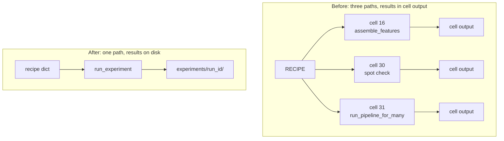
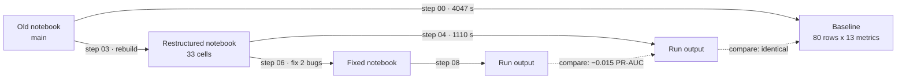

# Pipeline restructure, feature fixes, and distance selection

What changed between `main` and `pipeline-restructure`. Every number comes from
`scripts/` or `experiments/`, so you can reproduce it from this repository.

## Warnings

1. **Do not read the distance result as a result about distance.** The test is
   confounded. See [section 3](#3-distance-selection).
2. **Two averages appear in this repository.** The same run can be 0.1772 or
   0.2440. State the method whenever you quote either. See
   [section 1](#effect-of-the-fixes).
3. **Three verification scripts fail if you run them again.** The faults are in
   the test code, not the pipeline. See `scripts/README.md`.

## Summary

| Change | Alters results? |
|---|---|
| Fix two feature bugs | Yes. These are the only changes that alter results. |
| Restructure the pipeline | No. Verified identical on 80 rows x 13 metrics. |
| Add distance-based station selection | No. The capability is off by default. |

Support changes: `station_locations.py`, the `experiments/` run log, exact
dependency pins, nbstripout, and a tracked `scripts/` record.

## 1. Two feature bugs

### Bug 1: `precip_max` repeated `precip_sum`

The function had to return peak rainfall intensity. It returned cumulative
rainfall.

```sql
-- before
WITH summed AS (
    SELECT ..., COALESCE(SUM(b.precip_mm), 0) AS precip_mm   -- SUM
    ...
    GROUP BY r.sample_ts, b.station
)
PIVOT summed ON station USING MAX(precip_mm) GROUP BY sample_ts
```

The `GROUP BY` reduces each `(sample_ts, station)` pair to one row. `MAX` of one
row returns that row. Each `_max_` column was therefore byte-identical to its
`_sum_` column, for all 11 columns. Someone changed the outer aggregate to `MAX`
and left the inner one as `SUM`.

After: the CTE uses `COALESCE(MAX(b.precip_mm), 0)`. Nothing else changed.

20 mm of rain in one hour and 20 mm across six hours cause different runoff.
Only peak intensity separates them. The model received cumulative rainfall twice
and no intensity variable. Bucket width sets the unit: 60 minutes for City of
Chicago gauges, 5 minutes for USGS. Compare these columns within one source only.

### Bug 2: `groin_onshore` gave one NULL two meanings

```sql
-- before
CASE WHEN COUNT(w.is_onshore) >= {min_obs}
    THEN {groin_length_m}
       * AVG(w.is_onshore)
       * AVG(CASE WHEN w.is_onshore = 1 THEN w.WSPD ELSE NULL END)
    END AS groin_onshore_{wh}h_tol{tol}
```

Consider a window with no onshore wind. The inner `CASE` returns `NULL` for
every row, so `AVG` returns `NULL`. In SQL, `0 * NULL` is `NULL`, not `0`. The
product is therefore `NULL`, although `AVG(w.is_onshore)` is correctly `0`.

The outer `CASE` also returns `NULL`, for a different reason: the window holds
fewer than `min_obs` observations. One value encoded two facts:

- The wind was never onshore.
- There is not enough data to decide.

The median imputer cannot separate them. It replaced both with the median, which
is a typical onshore value. Calm windows then carried a high onshore value.

After: `COALESCE(..., 0)` encloses the third factor. `NULL` now means
insufficient coverage only, and no onshore wind gives `0`.

`scripts/07_verify_feature_fixes.py` confirms the result:

- 0 of 11 `_max_` columns still repeat their `_sum_` column.
- `groin_onshore` coverage at 6 hours rose from 167/503 to 475/503.
- 311 of the new values are `0`. These are the calm windows.
- The remaining NULL pattern matches `chii2_wspd_mean_6h` exactly, as expected
  if `NULL` means coverage only.

### How the two bugs differ

| | Bug 1: `precip_max` | Bug 2: `groin_onshore` |
|---|---|---|
| Fault | One aggregate in the wrong place | One encoding for two facts |
| Output | A wrong value that looks correct | A missing value, then an imputed value |
| Effect on data | Removed information | Added false information |
| Detection | Compare `_max_` and `_sum_` columns | Examine what `NULL` can mean |

### Effect of the fixes

Mean PR-AUC across all paired `(beach, model)` rows, excluding the dummy
baseline. Source: `scripts/08_run_and_compare_fixes.py`.

| Recipe | Before fix | After fix | Change |
|---|---|---|---|
| `wind_only` | 0.1912 | 0.1895 | −0.002 |
| `wind_geo` | 0.1922 | 0.1772 | −0.015 |
| `all_stations` | 0.1922 | 0.1772 | −0.015 |
| `radius_d10` | 0.1719 | 0.1639 | −0.008 |
| `radius_d15` | 0.1745 | 0.1741 | −0.000 |

The fixes did not improve performance. `wind_only` holds no groin features, so
it isolates the `precip_max` fix, which changed almost nothing. Both changes are
smaller than the noise at 64 test positives.

One result changed a conclusion. After the fix, `wind_only` scores 0.2538 and
`wind_geo` scores 0.2440, so `wind_only` is now higher. The earlier comparison
used a `groin_onshore` column that was mostly NULL. No evidence now shows that
the Mattheus groin interaction carries signal.

> **Warning: two averages.** The table above averages every `(beach, model)`
> row, which gives 0.1772 for `all_stations`. The README averages the best model
> per beach, which gives 0.2440 for the same run. Both are correct.

## 2. Why we restructured the pipeline

### Problems in the old notebook

`main` holds the old notebook: 40 cells, 34 code cells, 319 stored outputs. It
had three problems.

- **Dead code covered live code.** Cell 14 holds 139 lines; 84 are a
  commented-out copy of `build_wind_features`, directly above the live copy.
  Cell 15 is 51 percent comments. Cells 5, 35 and 38 are comments only.
- **Execution and definitions were interleaved.** Cell 16 calls
  `assemble_features` at the top level. Cells 20 to 26 then define
  `add_target`, `time_split`, `evaluate`, `run_all_models` and
  `threshold_sweep`. The notebook ran in one order only.
- **Three code paths produced the same numbers.** Cell 16, cell 30 and cell 31
  each built montrose features. A number from cell 16 did not have to agree
  with the number from cell 31, and nothing detected a disagreement. Results
  stayed in cell output, so a kernel restart deleted them.



### What replaced it

Sections: Setup, Reference data, Pipeline, Recipes, Runs, Compare, Figures. Four
rules control the notebook.

1. **The Pipeline section produces no output.** It holds definitions only. Parse
   cells 9 to 18 to confirm this. They contain no expression statements.
2. **One function starts every run.** All runs call `run_experiment(...)`,
   including a spot check on one beach. No second path exists.
3. **A recipe is a plain dict that converts to JSON.** It names dataframes by
   string, so you can store a recipe beside its results. Build a variant with
   `copy.deepcopy` and one edited key.
4. **Each run writes to `experiments/<run_id>/`.** Runs append, and nothing
   overwrites an earlier run. The Compare section reads from disk.

`meta.json` records the recipe and notebook hashes. It also records the git
commit, the dirty flag, the resolved stations, the dropped beaches, the elapsed
time and the package versions.

The notebook fell from 325,909 to 49,946 bytes. A full run fell from 4,047 s to
1,110 s, because the duplicate montrose builds are gone.

### How we verified that results did not change



Step 00 ran the **old** notebook cold and saved 80 result rows and 448 sweep
rows. Step 01 then matched the baseline exactly on 30 rows x 13 metrics, using
3 beaches and 2 recipes. Step 03 built the new notebook from the section banners
in `reference/pipeline_draft.py`, which copied code that had already passed step
01. Step 04 ran the new notebook end to end: **80 rows x 13 metrics, all values
identical**.

Note the order of work. Both bugs appeared in steps 06 to 08, after the
restructure. Step 07 found bug 1 by comparing `_max_` and `_sum_` columns across
one clean feature set. Three code paths make that comparison impractical. The
restructure did not fix the bugs. It made them visible.

## 3. Distance selection

### What it adds

`resolve_stations(beach, source, selection, beach_coords, declared)` selects the
stations of one source that feed one beach.

| Mode | Behaviour |
|---|---|
| `"all"` | Use the station list in the recipe. Validate each name, so a typo fails loudly. |
| `"radius"` | Use every station within `max_km`, nearest first. Apply the `min_stations` floor. |
| `"knn"` | Use the `k` nearest stations. |

The declared list gives every beach all 11 gauges, and distance does not change
the weight. Rainbow Beach therefore uses Winnetka, 42 km north, with the weight
of a gauge 600 m away. Against approximately 400 training rows, distant gauges
mostly dilute the signal. Radius mode tests whether their removal helps.

`min_stations` is a floor, and it applies to each source separately. If the
radius excludes every station of a source, the resolver keeps the nearest one.

> **Warning.** If the nearest gauge of a source lies outside `max_km`, the
> effective radius is larger than the label states. Read `resolved_stations` in
> `meta.json` to see which stations a run used.

The capability is off by default: the base recipe sets
`station_selection: {"mode": "all"}` and `distance: {"enabled": False}`. The
radius recipes change `station_selection` only. Step 05 confirmed the
`all_stations` control still equalled the baseline, which proves the resolver is
transparent when it does not filter. Nobody has run `radius_d5`.

### What it found

Feature counts fall as intended. Performance does not improve. PR-AUC is the
mean of the best model per beach, from the newest run of each recipe.

| Recipe | Features per beach | Mean PR-AUC |
|---|---|---|
| `wind_only` | 67 | 0.254 |
| `wind_geo` | 70 | 0.244 |
| `all_stations` | 70 | 0.244 |
| `radius_d15` | 35 to 55 | 0.223 |
| `radius_d10` | 30 to 35 | 0.213 |

`wind_only` and `wind_geo` differ by the three `groin_onshore_*` columns only.
Before the fixes, step 05 measured `all_stations` 0.271, `radius_d10` 0.236 and
`radius_d15` 0.219, with paired win rates of 13/32 and 15/32. That is no better
than chance.

> **Warning: the test is confounded.** The `63rd_street` City of Chicago gauge
> stopped reporting after 2022. It recorded 1 row in 2023, 11 in 2024 and 6 in
> 2025, against approximately 8,400 per year for `foster` and `oak_street`. The
> gauge records dry hours as zeros, so this is sensor loss. `63rd_street` is also
> the nearest City of Chicago gauge to the southern beaches, and the train/test
> split is chronological, so the outage falls inside the test window.
> `radius_d10` gives those beaches a dead station and discards two working ones.
> Data availability explains part of the decrease.

## 4. Support changes

- **`station_locations.py`** (new, 239 lines). Station coordinates, distance
  helpers and name validation. The coordinates live in the module because
  `.gitignore` excludes both source CSV files. Beach coordinates stay out of it
  and come from `dna_readings.parquet`, which keeps one source of truth.
- **`experiments/`**. The run log described above, with its own README.
- **`requirements.txt`**. Pins exact versions. Two requirements were missing:
  `pyarrow`, although every load calls `pd.read_parquet`, and `ipywidgets`,
  without which the Setup cell raises `InvalidInputException`. A new install
  previously failed on the first cell.
- **nbstripout**. Removes outputs at commit, so a diff shows code. Enable it
  once per clone: `nbstripout --install --attributes .gitattributes`.
- **`scripts/`**. Git now tracks the verification record.

## 5. How to verify this branch

Run this first. It needs the repository only. The committed sweep of 7 October
reproduces the README recipe table to three decimal places, from a different day
and working tree.

```python
import pandas as pd, glob, os
for label in ["wind_only","wind_geo","all_stations","radius_d10","radius_d15"]:
    d = sorted(glob.glob(f"experiments/*_{label}"))[-1]
    r = pd.read_csv(os.path.join(d, "results.csv"))
    nd = r[r["model"] != "dummy"]
    print(label, round(nd.groupby("beach")["pr_auc"].max().mean(), 3))
```

Two further checks use committed files only. Compare any future refactor against
`scripts/reference/baseline_master_results.csv`, the step 00 baseline of 80
rows. Recompute `recipe_sha256` from any `experiments/*/meta.json`: it is the
SHA-256 of `json.dumps(recipe, indent=2, sort_keys=True, default=str)`, and all
22 committed runs verify.

## 6. Limitations

- **The distance test is confounded.** See the warning in section 3.
- **The guard drops 5 of the 13 Mattheus beaches**: `osterman`, `foster`,
  `north_avenue`, `oak_street` and `oakwood`. The thresholds are
  `min_train_pos=10` and `min_test_pos=3`.
- **Results are weak.** The best PR-AUC per beach ranges from 0.44 (montrose) to
  0.04 (57th_street), against test base rates of 0.03 to 0.17.
- **`features.sewer`, `features.temp` and `features.distance` are declared but
  not implemented.** Work on combined sewer overflow stopped: only one CSO event
  (2023) reached Lake Michigan in this period.
- **Three scripts fail if you run them again**, and two USGS gauges have data
  faults that do not affect features. See `scripts/README.md`.
